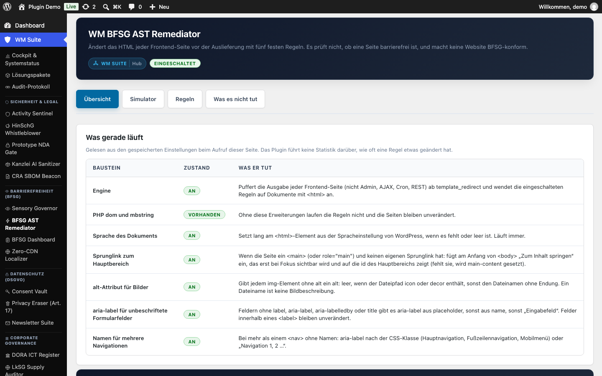
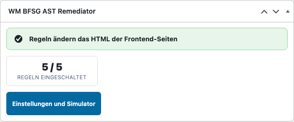

# WM BFSG AST Remediator (Deutsche Dokumentation)

<p align="center">
  <a href="README.md"></a>
  <a href="README.de.md"></a>
  <a href="README.es.md"></a>
</p>

> **Ändert das HTML jeder Frontend-Seite vor der Auslieferung mit fünf festen Regeln — `lang`-Attribut, Sprunglink zum Hauptbereich, `alt`-Attribut für Bilder, `aria-label` für unbeschriftete Formularfelder und Namen für mehrere Navigationen — und prüft dabei keine Seite auf Barrierefreiheit und macht keine Website BFSG- oder WCAG-konform**  
> **Plugin-Seite:** [https://arnoldwender.com/wordpress-plugins/wm-bfsg-ast-remediator/](https://arnoldwender.com/wordpress-plugins/wm-bfsg-ast-remediator/)  
> **Mit einem agentischen Workflow entwickelt:** entstanden mit KI-Coding-Agenten. Prüfen und testen Sie es wie jeden fremden Code, bevor Sie es produktiv einsetzen.  
> **Support & Haftung:** Kein Support (Zero Support) — reproduzierbare Bugs ausschließlich über [GitHub Issues](https://github.com/arnoldwender/wm-wp-bfsg-ast-remediator/issues) · kein privater Support · OHNE GEWÄHR („AS IS“) / keine Haftung ([SUPPORT.md](SUPPORT.md))

> Alle Angaben in dieser Datei sind am Quellcode dieses Repositorys gemessen (`v1.2.2`). Frühere Entwürfe beschrieben Prüf-, Siegel-, Export-, Datenbankprotokoll- und Konformitätsfunktionen, die nicht Bestandteil dieses Plugins sind; WP-CLI lautet `wp bfsg status` und `wp bfsg remediate`, REST lautet `POST /wp-json/wm-bfsg/v1/remediate-html`, und der Simulator im Backend nutzt exakt dieselbe Engine wie der Ausgabepuffer im Frontend.

---

## Screenshots

!WM BFSG AST Remediator Banner

| Screenshot | Beschreibung |
| --- | --- |
|  | Server-seitige DOMDocument-HTML-Korrektur für lang-Attribute, Sprunglinks, Labels und Navigation |
|  | WordPress-Dashboard-Widget mit aktiven HTML-AST-Korrekturwerten |

---

## Was das Plugin leistet

1. **Ausgabepuffer:** Bei `template_redirect` (Priorität 1), nur für Frontend-Anfragen (nicht Admin, AJAX, Cron oder REST), solange der Schalter `wm_bfsg_remediator_enabled` an ist und PHP `ext-dom` und `ext-mbstring` hat, wird die Seitenausgabe gepuffert. Ein Puffer mit `<html` wird mit `DOMDocument` geparst (`LIBXML_NONET`, keine externen Entities); die eingeschalteten Regeln laufen; ein Dokument, das keine Regel geändert hat, geht unverändert hinaus. Vorzeitig ausgegebene Teile (`ob_flush`) werden zurückgehalten, und die Seite wird einmal umgeformt, wenn der Puffer schließt. Nach einer Änderung wird das Dokument neu serialisiert, und nur die benannten Entities, die dabei für Nicht-ASCII-Text entstehen, werden zurückgewandelt, sodass vom Theme maskiertes Markup maskiert bleibt.
2. **Sprache des Dokuments:** Ein `<html>` ohne oder mit leerem `lang` bekommt die WordPress-Spracheinstellung (`de_DE` wird `de-DE`). Kein eigener Schalter; läuft, solange die Engine läuft.
3. **Sprunglink:** Hat die Seite ein `<main>` (oder `role="main"`) und keinen eigenen Sprunglink (ein seiteninterner Link auf diesen Bereich, oder einer, dessen Klasse `skip` oder dessen Text „Inhalt“ oder „skip to“ enthält), wird am Anfang von `<body>` der Link „Zum Inhalt springen“ auf die id des Bereichs eingefügt; ein Bereich ohne id bekommt `main-content` (`main-content-2` usw., wenn ein anderes Element diese id schon trägt). Ein `<style>` im `<head>` hält den Link außerhalb des Bildschirms, bis er den Fokus bekommt, in Systemfarben. Seiten ohne Hauptbereich bekommen keinen Link.
4. **`alt` für Bilder:** Jedes `` ohne `alt` bekommt eines: leer, wenn der URL-Pfad `icon` oder `decor` enthält (unabhängig von Groß- und Kleinschreibung) oder kein Dateiname übrig bleibt, auch bei einem `src`, der sich nicht als URL lesen lässt, sonst den Dateinamen ohne Endung, Trennzeichen als Leerzeichen, erster Buchstabe groß (`IMG_2034.jpg` wird „IMG 2034“).
5. **Formularfelder:** `input` (außer hidden, submit, button, reset und image), `select` und `textarea` ohne `aria-label`, `aria-labelledby`, `title`, umschließendes `<label>` oder `<label for>` auf ihre id bekommen `aria-label` aus `placeholder`, sonst aus `name` (erster Buchstabe groß), sonst „Eingabefeld“.
6. **Navigationsnamen:** Haben mehrere `<nav>` keinen Namen, bekommt jede `aria-label` „Hauptnavigation“ (Klasse enthält main, primary oder header), „Fußzeilennavigation“ (footer), „Mobilmenü“ (mobile) oder „Navigation N“.
7. **Backend & Deinstallation:** Menü *BFSG Remediator* (Position 81), Seite `wm-bfsg-remediator`: *Übersicht* (Engine, PHP-Erweiterungen und jede Regel wie gespeichert), *Simulator* (ein vollständiges HTML-Dokument einfügen und Ausgabe sowie Regelcodes derselben Engine mit den gespeicherten Schaltern sehen), *Regeln* (Engine-Schalter, vier Regelschalter und das Opt-in-Kontrollkästchen `wm_bfsg_remediator_delete_data_on_uninstall`, sodass Optionen bei der Deinstallation standardmäßig erhalten bleiben) und *Was es nicht tut*. Übersetzungskataloge in `languages/` decken 28 Gebietsschemata ab und werden über `load_plugin_textdomain()` bei `init` geladen.
8. **REST:** `POST /wp-json/wm-bfsg/v1/remediate-html` mit `raw_html` (`manage_options`) liefert die Ausgabe desselben Transformers: 400 bei leerer Eingabe, 413 über 500 KB, 422 für ein Fragment ohne `<html>` (auch der Puffer lässt Fragmente unverändert), 503 ohne `ext-dom` oder `ext-mbstring`.
9. **WP-CLI:** `wp bfsg status` gibt die gespeicherten Schalter aus und ob die PHP-Erweiterungen vorhanden sind; `wp bfsg remediate <datei> [--write]` wendet die Regeln auf eine HTML-Datei an, listet die Regelcodes und schreibt das Ergebnis auf Wunsch zurück (Fehler, wenn die Datei nicht beschreibbar ist). Die Codes nennen das WCAG-Kriterium, auf das sich eine Regel bezieht, und enden auf `ADDED`; sie sind keine Prüfergebnisse.
10. **Erweiterbarkeit, Block Bindings, GenerateBlocks & WM Suite Hub Spoke:** Bietet die Filter `wm_bfsg_remediator_rules_config` und `wm_bfsg_remediator_html_output` sowie die Action `wm_bfsg_remediator_ready`, registriert die WordPress-6.5+-Block-Bindings-Quelle `wm-bfsg-remediator/status` und das GenerateBlocks-2.x-Dynamic-Tag `{{wm_bfsg_remediator_status}}` für sachliche Laufzeitstatuswerte und meldet sich bei aktivem `wm-suite-hub` über `wm_register_suite_module` an.

### Nicht enthalten

Keine Prüfung der Seiten auf Barrierefreiheit, kein Bericht, Siegel oder Zertifikat und keine Bewertung, ob eine Website BFSG, BITV 2.0, WCAG oder EN 301 549 erfüllt; keine Änderung an Kontrasten, Überschriftenhierarchie, Tastaturbedienung, Fokus, Schaltflächen- oder Linktexten, Medien, PDFs oder per JavaScript geladenen Inhalten; keine eigenen Datenbanktabellen oder Statistiken darüber, was die Regeln geändert haben; keine Seitenausnahme in der Oberfläche (programmatisch über `wm_bfsg_remediator_rules_config` möglich).

---

## Schnellstart

1. Plugin installieren und aktivieren (WordPress 6.4+, PHP 8.1+ mit `dom` und `mbstring`). Die Regeln laufen sofort, alle Regelschalter sind an.
2. Unter **BFSG Remediator › Simulator** den HTML-Quelltext einer eigenen Seite einfügen und sehen, was die Regeln ändern würden.
3. Unter **Regeln** ausschalten, was das Theme schon richtig macht oder was nicht gewünscht ist; die ganze Engine hat einen eigenen Schalter, und bei der Deinstallation bleiben gespeicherte Einstellungen standardmäßig erhalten.
4. Was die Regeln nur überdecken — fehlende Bildbeschreibungen, fehlende Feldbeschriftungen, ein fehlender Sprunglink — im Theme und im Inhalt beheben.

Dateien, Regeln im Detail, Hooks, REST-Route und Hub-Adapter: **[README.md](README.md)** (Referenz) und **[DEVELOPERS.md](DEVELOPERS.md)**.

```bash
php tests/test-suite.php
php tests/test-pot-freshness.php
bash tests/run-mutations.sh
```

### Bekannte Einschränkungen

- Ein Dateiname als `alt` und `name` oder `placeholder` als `aria-label` sind Notbehelfe, keine Beschreibungen oder Beschriftungen. Sie können eine automatische Prüfung stiller machen, während eine Person mit Screenreader weiterhin keine brauchbare Information bekommt.
- Die Engine läuft bei jeder ungecachten Frontend-Anfrage und parst die ganze Seite neu; ein Seiten-Cache behält, was er vor der Aktivierung oder vor einer Schalteränderung gespeichert hat.
- Nach einer Regel wird das Dokument vom HTML-Parser von libxml neu serialisiert: Attributnamen kommen kleingeschrieben zurück (`viewBox` wird `viewbox`, was die HTML-Parser der Browser für SVG wiederherstellen), leere Elemente bekommen schließende Tags.
- Die Sprache kommt aus der Spracheinstellung der Website, auch auf einer Seite in anderer Sprache; der eingefügte Text des Sprunglinks lautet „Zum Inhalt springen“.
- Navigationsnamen hängen an CSS-Klassennamen.
- Ein Theme oder Plugin, das Ausgabe früh sendet, damit die ersten Bytes schneller ankommen, verliert diesen Effekt, solange die Engine läuft: die Ausgabe wartet auf das Seitenende.

---

## Konformität

- **Was das Plugin mit einer Seite macht:** Es ergänzt fünf Arten von Attributen und Elementen im ausgelieferten HTML. Es prüft die Seite nicht, ersetzt nicht die Korrektur von Theme und Inhalt und bewertet nicht, ob eine Website BFSG, BITV 2.0, WCAG oder EN 301 549 genügt.
- **Ausgehende Anfragen:** keine. Der Parser läuft mit `LIBXML_NONET`.
- **Personenbezogene Daten:** Außer der Seitenausgabe selbst wird nichts verarbeitet oder gespeichert; das Plugin führt kein Protokoll.

---

## Lizenz

Vertrieben unter der **GNU General Public License v2 oder neuer** (`GPL-2.0-or-later`).  
Copyright (C) 2026 Arnold Wender.  
