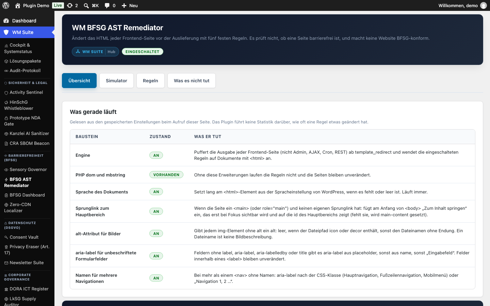
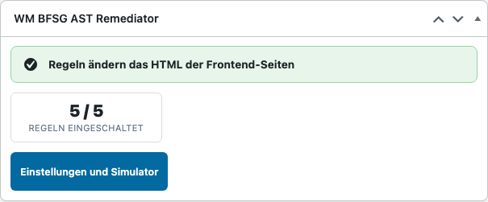

# WM BFSG AST Remediator (Documentación en Español)

<p align="center">
  <a href="README.md"></a>
  <a href="README.de.md"></a>
  <a href="README.es.md"></a>
</p>

> **Reescribe el HTML de cada página del frontend antes de enviarla con cinco reglas fijas — atributo `lang`, enlace de salto al área principal, atributo `alt` en imágenes, `aria-label` en campos de formulario sin nombre y nombres para varias navegaciones — y no revisa la accesibilidad de ninguna página ni vuelve un sitio conforme con BFSG o WCAG**  
> **Página del Plugin:** [https://arnoldwender.com/es/plugins-wordpress/wm-bfsg-ast-remediator/](https://arnoldwender.com/es/plugins-wordpress/wm-bfsg-ast-remediator/)  
> **Desarrollado con un agentic workflow:** creado con agentes de programación de IA. Revísalo y pruébalo como cualquier código de terceros antes de usarlo en producción.  
> **Soporte y responsabilidad:** Cero soporte (Zero Support) — errores reproducibles únicamente en [GitHub Issues](https://github.com/arnoldwender/wm-wp-bfsg-ast-remediator/issues) · sin soporte privado · TAL CUAL («AS IS») / sin responsabilidad ([SUPPORT.md](SUPPORT.md))

> Todo lo descrito en este documento está medido frente al código real del repositorio (`v1.2.2`). Borradores preliminares describían funciones de auditoría, sellos, exportación, registro en base de datos y certificación legal que no forman parte de este plugin; WP-CLI es `wp bfsg status` y `wp bfsg remediate`, REST es `POST /wp-json/wm-bfsg/v1/remediate-html`, y el simulador de administración ejecuta exactamente el mismo motor que el búfer del frontend.

---

## Capturas de pantalla

!Banner de WM BFSG AST Remediator

| Captura | Descripción |
| --- | --- |
|  | Corrección HTML del lado del servidor mediante DOMDocument para atributos lang, enlaces de salto y formularios |
|  | Widget del escritorio de WordPress con contadores de saneamiento HTML AST activos |

---

## Qué hace el plugin

1. **Búfer de salida:** en `template_redirect` (prioridad 1), solo en peticiones del frontend (no admin, AJAX, cron ni REST), mientras el interruptor `wm_bfsg_remediator_enabled` esté encendido y PHP tenga `ext-dom` y `ext-mbstring`, se almacena la salida de la página. Un búfer con `<html` se analiza con `DOMDocument` (`LIBXML_NONET`, sin entidades externas); corren las reglas encendidas; un documento que ninguna regla cambió sale tal como llegó. La salida enviada antes de tiempo (`ob_flush`) se retiene y la página se transforma una sola vez, al cerrarse el búfer. Tras un cambio el documento se vuelve a serializar y solo se decodifican las entidades con nombre que esa serialización genera para texto no ASCII, así que el marcado que el tema escapó sigue escapado.
2. **Idioma del documento:** un `<html>` sin `lang`, o con uno vacío, recibe el idioma de WordPress (`de_DE` pasa a `de-DE`). Sin interruptor propio; corre siempre que corre el motor.
3. **Enlace de salto:** si la página tiene un `<main>` (o `role="main"`) y ningún enlace de salto propio (un enlace interno a ese área, o uno cuya clase contenga `skip` o cuyo texto contenga «Inhalt» o «skip to»), se inserta al inicio de `<body>` el enlace «Zum Inhalt springen» hacia el id del área; un área sin id recibe `main-content` (`main-content-2` y así sucesivamente cuando otro elemento ya tiene ese id). Un `<style>` en `<head>` mantiene el enlace fuera de pantalla hasta que recibe el foco, en colores del sistema. Las páginas sin área principal no reciben enlace.
4. **`alt` en imágenes:** cada `` sin `alt` recibe uno: vacío si la ruta de la URL contiene `icon` o `decor` (sin importar mayúsculas) o no queda nombre de archivo, también con un `src` que no se puede leer como URL, si no el nombre del archivo sin extensión, con separadores como espacios y la primera letra en mayúscula (`IMG_2034.jpg` pasa a «IMG 2034»).
5. **Campos de formulario:** `input` (salvo hidden, submit, button, reset e image), `select` y `textarea` sin `aria-label`, `aria-labelledby`, `title`, `<label>` que los envuelva ni `<label for>` hacia su id reciben `aria-label` a partir de `placeholder`, si no de `name` (primera letra en mayúscula), si no «Eingabefeld».
6. **Nombres de navegación:** si más de un `<nav>` no tiene nombre, cada uno recibe `aria-label` «Hauptnavigation» (clase con main, primary o header), «Fußzeilennavigation» (footer), «Mobilmenü» (mobile) o «Navigation N».
7. **Administración y desinstalación opcional:** menú *BFSG Remediator* (posición 81), página `wm-bfsg-remediator`: *Übersicht* (motor, extensiones de PHP y cada regla tal como está guardada), *Simulator* (pegar un documento HTML completo y ver la salida y los códigos de regla del mismo motor con los interruptores guardados), *Regeln* (el interruptor del motor, cuatro interruptores de reglas y la casilla opcional `wm_bfsg_remediator_delete_data_on_uninstall`, desactivada por defecto para conservar las opciones al desinstalar) y *Was es nicht tut*. Los catálogos en `languages/` cubren 28 configuraciones regionales y se cargan mediante `load_plugin_textdomain()` en `init`.
8. **REST:** `POST /wp-json/wm-bfsg/v1/remediate-html` con `raw_html` (`manage_options`) devuelve la salida del mismo transformador: 400 con entrada vacía, 413 por encima de 500 KB, 422 para un fragmento sin `<html>` (el búfer también deja los fragmentos intactos), 503 sin `ext-dom` o `ext-mbstring`.
9. **WP-CLI:** `wp bfsg status` imprime los interruptores guardados y si existen las extensiones de PHP; `wp bfsg remediate <archivo> [--write]` aplica las reglas a un archivo HTML, lista los códigos de regla y, si se pide, escribe el resultado (error si el archivo no se puede escribir). Los códigos nombran el criterio WCAG al que se refiere una regla y terminan en `ADDED`; no son resultados de conformidad.
10. **Extensibilidad, Block Bindings, GenerateBlocks y Spoke de WM Suite Hub:** expone los filtros `wm_bfsg_remediator_rules_config` y `wm_bfsg_remediator_html_output` junto con la acción `wm_bfsg_remediator_ready`, registra la fuente de Block Bindings de WordPress 6.5+ `wm-bfsg-remediator/status` y la etiqueta dinámica de GenerateBlocks 2.x `{{wm_bfsg_remediator_status}}`, y cuando `wm-suite-hub` está activo se integra mediante `wm_register_suite_module`.

### No incluido

Ninguna revisión de accesibilidad de las páginas, ningún informe, sello ni certificado y ninguna evaluación de si un sitio cumple BFSG, BITV 2.0, WCAG o EN 301 549; ningún cambio en contraste, orden de encabezados, uso con teclado, foco, textos de botones o enlaces, multimedia, PDF ni contenido cargado por JavaScript; ninguna tabla propia ni estadística de lo que cambiaron las reglas; ninguna exclusión por página en la interfaz (disponible por código mediante `wm_bfsg_remediator_rules_config`).

---

## Inicio rápido

1. Instala y activa el plugin (WordPress 6.4+, PHP 8.1+ con `dom` y `mbstring`). Las reglas corren de inmediato con todos los interruptores de reglas encendidos.
2. En **BFSG Remediator › Simulator** pega el código HTML de una de tus páginas y mira qué cambiarían las reglas.
3. En **Regeln** apaga lo que tu tema ya hace bien o lo que no quieras; el motor completo tiene su propio interruptor y la desinstalación conserva tus ajustes salvo que marques el borrado opcional.
4. Corrige en el tema y en el contenido lo que las reglas solo tapan: descripciones de imágenes, etiquetas de formularios y un enlace de salto que falten.

Archivos, reglas en detalle, hooks, ruta REST y adaptador del hub: **[README.md](README.md)** (referencia) y **[DEVELOPERS.md](DEVELOPERS.md)**.

```bash
php tests/test-suite.php
php tests/test-pot-freshness.php
bash tests/run-mutations.sh
```

### Problemas conocidos

- Un nombre de archivo como `alt` y `name` o `placeholder` como `aria-label` son parches, no descripciones ni etiquetas. Pueden callar un verificador automático mientras una persona con lector de pantalla sigue sin información útil.
- El motor corre en cada petición del frontend sin caché y vuelve a analizar la página completa; una caché de páginas conserva lo que guardó antes de activar el plugin o de cambiar un interruptor.
- Tras aplicar una regla, el analizador HTML de libxml vuelve a serializar el documento: los nombres de atributo salen en minúsculas (`viewBox` pasa a `viewbox`, que los analizadores HTML de los navegadores restauran en SVG) y los elementos vacíos se escriben con etiqueta de cierre.
- El idioma sale de la configuración del sitio, aun en una página escrita en otro idioma; el texto insertado en el enlace de salto es «Zum Inhalt springen».
- Los nombres de navegación dependen de los nombres de clase CSS.
- Un tema o plugin que envía salida pronto para que lleguen antes los primeros bytes pierde ese efecto mientras corre el motor: la salida espera al final de la página.

---

## Cumplimiento

- **Qué le hace el plugin a una página:** agrega o completa cinco tipos de atributos y elementos en el HTML que se envía. No audita la página, no sustituye corregir el tema y el contenido y no evalúa si un sitio cumple BFSG, BITV 2.0, WCAG o EN 301 549.
- **Peticiones salientes:** ninguna. El analizador corre con `LIBXML_NONET`.
- **Datos personales:** no se procesa ni guarda nada aparte de la propia salida de la página; el plugin no lleva registro.

---

## Licencia

Distribuido bajo licencia **GNU General Public License v2 o posterior** (`GPL-2.0-or-later`).  
Copyright (C) 2026 Arnold Wender.  
