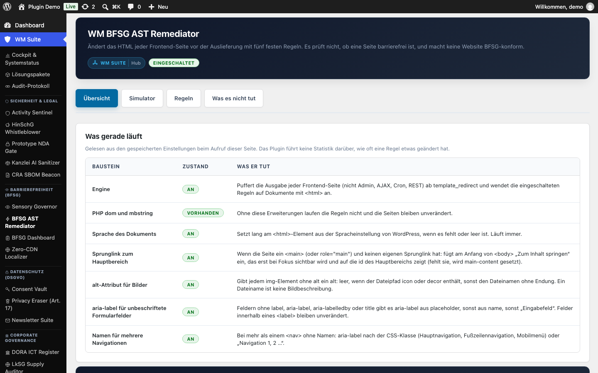

# WM BFSG AST Remediator (Deutsch)

  [🇧🇬 Български](README.bg.md) • [🇨🇿 Čeština](README.cs.md) • [🇩🇰 Dansk](README.da.md) • [🇩🇪 Deutsch](../../README.de.md) • [🇬🇷 Ελληνικά](README.el.md) • [🇬🇧 English](../../README.md) • [🇪🇸 Español](../../README.es.md) • [🇪🇪 Eesti](README.et.md) • [🇫🇮 Suomi](README.fi.md) • [🇫🇷 Français](README.fr.md) • [🇮🇪 Gaeilge](README.ga.md) • [🇭🇷 Hrvatski](README.hr.md) [🇭🇺 Magyar](README.hu.md) • [🇮🇹 Italiano](README.it.md) • [🇱🇹 Lietuvių](README.lt.md) • [🇱🇻 Latviešu](README.lv.md) • [🇲🇹 Malti](README.mt.md) • [🇳🇱 Nederlands](README.nl.md) • [🇵🇱 Polski](README.pl.md) • [🇵🇹 Português](README.pt.md) • [🇷🇴 Română](README.ro.md) • [🇸🇰 Slovenčina](README.sk.md) • [🇸🇮 Slovenščina](README.sl.md) • [🇸🇪 Svenska](README.sv.md)

---

  
  
  
  
  

> **Rewrites the HTML of every frontend page before it is sent, with five fixed rules — a `lang` attribute, a skip link to the main landmark, `alt` attributes on images, `aria-label` on unnamed form controls and names for several navigations — and it does not check pages for accessibility or make a site BFSG or WCAG conformant**  
> **Plugin-Seite:** [https://arnoldwender.com/wordpress-plugins/wm-bfsg-ast-remediator/](https://arnoldwender.com/wordpress-plugins/wm-bfsg-ast-remediator/)  
> **Mit einem agentischen Workflow entwickelt:** entstanden mit KI-Coding-Agenten. Prüfen und testen Sie es wie jeden fremden Code, bevor Sie es produktiv einsetzen.  
> **Support & Liability:** Zero support — reproducible bugs on [GitHub Issues](https://github.com/arnoldwender/wm-wp-bfsg-ast-remediator/issues) only · no private support · AS IS / no liability ([SUPPORT.md](../../SUPPORT.md))

---

## 📸 Deutsch Enterprise Showcase

!WM BFSG AST Remediator Banner

---

## 🟢 STUFE 1: SCHNELLSTART-ANLEITUNG FÜR EINSTEIGER & WEBSITE-BETREIBER (NO-CODE)

### Was leistet dieses Plugin für Ihre Website?
Rewrites the HTML of every frontend page before it is sent, with five fixed rules — a `lang` attribute, a skip link to the main landmark, `alt` attributes on images, `aria-label` on unnamed form controls and names for several navigations — and it does not check pages for accessibility or make a site BFSG or WCAG conformant

### 🚀 In 2 Minuten startklar (Schritt-für-Schritt ohne Code):
1. Install and activate the plugin (WordPress 6.4+, PHP 8.1+ with `dom` and `mbstring`). The rules run immediately with every rule switch on.
2. Open **BFSG Remediator › Simulator** and paste the HTML source of one of your pages to see what the rules would change.
3. Switch off under **Regeln** what your theme already does correctly or what you do not want; the whole engine has its own switch, and uninstalling keeps your saved switches unless you opt in to deletion.
4. Fix what the rules only paper over — missing image descriptions, missing form labels, a missing skip link — in the theme and the content.

### 💡 Häufig gestellte Fragen für Einsteiger:
#### ❓ What is not included?
No check of pages for accessibility, no audit report, certification seal or compliance verdict, and no assessment of whether a site meets BFSG, BITV 2.0, WCAG or EN 301 549; no changes to contrast, heading order, keyboard operation, focus, button or link texts, media, PDFs or content loaded by JavaScript; no custom database tables or statistics of what the rules changed; no per-page exclusion UI (per-request rule overrides are available programmatically via `wm_bfsg_remediator_rules_config`).

---

## 🟡 STUFE 2: WEBMASTER & ADMINISTRATOREN-HANDBUCH

### What the plugin does
1. **Output buffer.** At `template_redirect` (priority 1), on frontend requests only (not admin, AJAX, cron or REST), while the switch `wm_bfsg_remediator_enabled` is on and PHP has `ext-dom` and `ext-mbstring`, the page output is buffered. A buffer containing `<html` is parsed with `DOMDocument` (`LIBXML_NONET`, no external entities); the switched-on rules run; a document no rule changed is sent exactly as it came. Output flushed before the end of the page is held back, and the page is transformed once, when the buffer closes. After a change the document is re-serialised, and only the named entities that serialisation produces for non-ASCII text are decoded, so markup the theme escaped stays escaped.
2. **Document language.** An `<html>` without `lang`, or with an empty one, gets the WordPress locale (`de_DE` becomes `de-DE`). No switch; runs whenever the engine does.
3. **Skip link.** When the page has a `<main>` (or `role="main"`) and no skip link of its own (a same-page link to that landmark, or one whose class contains `skip` or whose text contains "Inhalt" or "skip to"), a link "Zum Inhalt springen" is inserted at the start of `<body>`, pointing at the landmark's id; a landmark without id gets `main-content` (`main-content-2` and so on when another element already carries that id). A `<style>` in `<head>` keeps the link off screen until it is focused, in system colours. Pages without a landmark get no link.
4. **Image `alt`.** Every `` without `alt` gets one: empty when the URL path contains `icon` or `decor` (in any case) or no file name is left, including a `src` that does not parse as a URL, otherwise the file name without extension, separators replaced by spaces and the first letter capitalised (`IMG_2034.jpg` becomes "IMG 2034").
5. **Form controls.** `input` (except hidden, submit, button, reset and image), `select` and `textarea` without `aria-label`, `aria-labelledby`, `title`, an enclosing `<label>` or a `<label for>` pointing at their id get `aria-label` from `placeholder`, else from `name` (first letter capitalised), else "Eingabefeld".
6. **Navigation names.** When more than one `<nav>` has no name, each gets `aria-label` "Hauptnavigation" (class contains main, primary or header), "Fußzeilennavigation" (footer), "Mobilmenü" (mobile) or "Navigation N".
7. **Admin & opt-in uninstall.** Menu *BFSG Remediator* (position 81), page `wm-bfsg-remediator`: *Übersicht* (engine, PHP extensions and each rule as saved), *Simulator* (paste a full HTML document and see the output and rule codes of the same engine with the saved switches), *Regeln* (the engine switch, four rule switches, and the opt-in `wm_bfsg_remediator_delete_data_on_uninstall` checkbox — off by default so uninstalling preserves settings unless explicitly enabled) and *Was es nicht tut*. A dashboard widget shows whether the rules run and how many are switched on. Translations in `languages/` cover 28 locales and load via `load_plugin_textdomain()` on `init` for WordPress 6.4–6.7 alongside WordPress 6.8+ automatic loading.
8. **REST.** `POST /wp-json/wm-bfsg/v1/remediate-html` with `raw_html` (`manage_options`) returns the output of the same transformer: 400 for empty input, 413 above 500 KB, 422 for a fragment without `<html>` (the buffer leaves fragments alone too), 503 without `ext-dom` or `ext-mbstring`.
9. **WP-CLI.** `wp bfsg status` prints the saved switches and whether the PHP extensions exist; `wp bfsg remediate <file> [--write]` runs the rules on an HTML file and lists the rule codes, optionally writing the result back (an error when the file cannot be written). The codes name the WCAG criterion a rule relates to and end in `ADDED`; they are not conformance results.
10. **Extensibility, Block Bindings, GenerateBlocks & WM Suite Hub spoke.** Exposes filters `wm_bfsg_remediator_rules_config` and `wm_bfsg_remediator_html_output` plus action `wm_bfsg_remediator_ready`; registers WordPress 6.5+ Block Bindings source `wm-bfsg-remediator/status` and GenerateBlocks 2.x dynamic tag `{{wm_bfsg_remediator_status}}` for factual runtime status display; and when `wm-suite-hub` is active, `includes/Adapters/Bfsg_Remediator_Spoke_Adapter.php` registers through `wm_register_suite_module` (`HEALTHY`, `NEEDS_CONFIG` or `ERROR`, saved-switch telemetry, `self_test`, and CycloneDX SBOM metadata matching `bom.json`).

### Not shipped
No check of pages for accessibility, no audit report, certification seal or compliance verdict, and no assessment of whether a site meets BFSG, BITV 2.0, WCAG or EN 301 549; no changes to contrast, heading order, keyboard operation, focus, button or link texts, media, PDFs or content loaded by JavaScript; no custom database tables or statistics of what the rules changed; no per-page exclusion UI (per-request rule overrides are available programmatically via `wm_bfsg_remediator_rules_config`).

---

## 🔴 STUFE 3: ENTWICKLER & SOFTWARE-ARCHITEKTEN

Classes, hooks, options, the admin screen and the WM Suite Hub adapter are documented in the English manual: **[DEVELOPERS.md](../../DEVELOPERS.md)**.

---

## ⚖️ Gesetzliche Grundlagen & EU-Konformität

- **What the plugin does to a page:** adds or fills in five kinds of attributes and elements in the HTML that is sent. It does not audit the page, does not replace fixing theme and content, and does not assess whether a site satisfies BFSG, BITV 2.0, WCAG or EN 301 549.
- **Outbound requests:** none. The parser runs with `LIBXML_NONET`.
- **Personal data:** none processed or stored beyond the page output itself; the plugin keeps no log.

---

## 🔒 Lizenz & Urheberrecht

Distributed under the **GNU General Public License v2 or later**.  
Copyright (C) 2026 Arnold Wender.  
